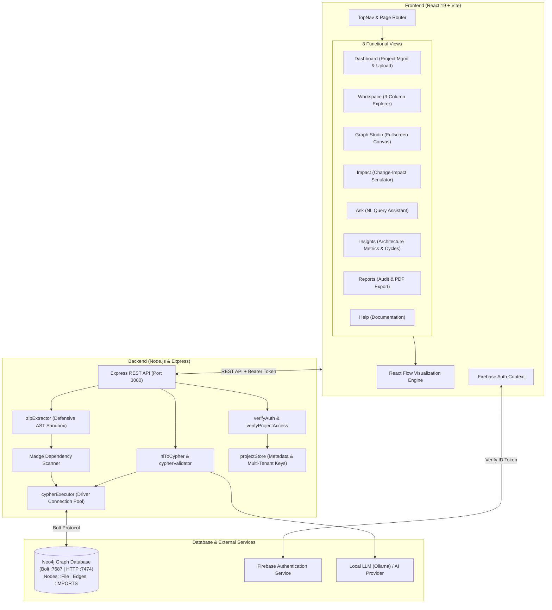

# RippleCheck ⚡
> **AI-Powered Code Dependency Graphing & Change-Impact Intelligence Platform**

RippleCheck transforms complex JavaScript and TypeScript codebases into interactive dependency topology graphs. It empowers software architects and engineers to visualize multi-module architecture, calculate ripple effects and blast radiuses before refactoring, execute natural-language queries against graph schemas, detect architectural cycles, and export audit-ready reports.

---

## 🌟 Key Features

- **Interactive Multi-Layout Dependency Graph**
  - Visualize files and import relationships with **React Flow**.
  - Four layout engines:
    - **DAG (Hierarchical)**: Longest-path layered layout via Dagre.
    - **Horizontal DAG**: Left-to-right module flow for broad architectures.
    - **Radial Blast Radius**: Dynamic concentric ring projection around selected impact epicenters.
    - **Tree Layout**: Root-to-leaf spanning tree architecture.
- **Automated Change-Impact Simulation (Impact Analysis)**
  - Simulate **Modify**, **Delete**, or **Rename** actions on any file.
  - Distinguishes **1-hop direct broken importers** from **2+ hop transitive ripple effects**.
  - Reconstructs complete propagation path chains (`Module A → Service B → Controller C → Server`).
- **Natural-Language Repository AI Assistant (Ask)**
  - Ask plain-English questions about architecture, imports, and dependencies.
  - Automatically translates questions into strictly scoped, read-only Cypher queries with AST validation and injection guardrails.
  - View both generated Cypher syntax and tabular result sets.
- **Architectural Health & Metrics (Insights)**
  - Real-time graph analytics calculated across all files and dependencies:
    - **Fan-In Analysis**: Identifies most depended-upon foundational modules.
    - **Fan-Out Analysis**: Identifies heaviest consumer and orchestration files.
    - **Dead Code / Isolation Detection**: Flags files with zero incoming or outgoing dependencies.
    - **Circular Dependency Detection**: Depth-First Search (DFS) algorithm finds recursive cycles and circular loops.
- **Executive Audit & Printable Reports (Reports)**
  - Executive project summary with dependency density metrics.
  - Target file blast radius summaries and full module inventory tables.
  - One-click exports for high-resolution **PNG**, vector **SVG**, and raw **JSON**.
  - Clean `@media print` layout for instant **Print-to-PDF** architectural audits.
- **Multi-Tenant Project Isolation & Secure Ingestion**
  - Multi-user authentication backed by **Firebase Auth**.
  - Secure repository ZIP ingestion with defensive guardrails:
    - Zip Bomb protection (compression ratio limits).
    - Zip Slip / path traversal rejection.
    - Safe AST parsing via Madge (zero code execution).
    - Multi-project isolation enforced at the database query level.

---

## 🏛️ System Architecture



---

## 💻 Tech Stack

### Frontend
- **Framework**: React 19, Vite
- **Graph Visualization**: `@xyflow/react` (React Flow)
- **Graph Layout Engines**: Dagre, Custom Concentric Radial BFS, Tree & Force Algorithms
- **Icons & UI**: Lucide React
- **Export Engines**: `html-to-image` (High-res PNG, SVG rasterizer)
- **Authentication**: Firebase Authentication SDK (Google & Email/Password)

### Backend
- **Runtime**: Node.js (v20+ / v24+)
- **API Framework**: Express, CORS, Multer
- **AST Dependency Scanning**: Madge (Babel AST traversal)
- **Archive Extraction**: Adm-Zip with security validation checks
- **Database Driver**: `neo4j-driver` (v5+)
- **AI Query Engine**: Custom AST Cypher validator, Few-shot Schema Prompter, Ollama / Gemini provider integrations

### Database & Infrastructure
- **Graph Database**: Neo4j 5 Community Edition
- **Containerization**: Docker & Docker Compose
- **Security**: Strict multi-project Cypher scoping, parameter binding, non-root execution

---

## 📸 Application Views

| Page | Purpose |
| :--- | :--- |
| **Dashboard** | Upload repository ZIPs, manage projects, and select active workspaces. |
| **Workspace** | Interactive 3-column view: File Explorer, React Flow Canvas, and Details Inspector. |
| **Graph Studio** | Fullscreen graph exploration with layout switching, fit-to-screen, and node filtering. |
| **Impact Analysis** | Change-impact analysis simulating modifications, deletions, and renames with hop cascades. |
| **Ask** | Natural-language query interface with Cypher generation, table results, and history. |
| **Insights** | Architecture metrics: Fan-in, Fan-out, isolated files, and circular loop detection. |
| **Reports** | Printable executive summary, module inventory, and PNG/SVG/JSON exports. |
| **Help Guide** | In-app documentation and quick reference guide. |

---

## 🚀 Getting Started

### Prerequisites
- [Node.js](https://nodejs.org/) (v20.0.0 or higher)
- [npm](https://www.npmjs.com/)
- [Docker Desktop](https://www.docker.com/products/docker-desktop/) (for Neo4j)

---

### 1. Clone the Repository
```bash
git clone https://github.com/your-username/ripplecheck.git
cd ripplecheck
```

---

### 2. Configure Environment Variables

#### Backend Configuration
Copy the sample environment file to `.env`:
```bash
cp .env.example .env
```
Edit `.env` to configure your settings:
```env
# Neo4j Database Connection
NEO4J_URI=bolt://localhost:7687
NEO4J_USERNAME=neo4j
NEO4J_PASSWORD=your_secure_password_here

# AI Service Provider (e.g. ollama, gemini)
AI_PROVIDER=ollama

# Firebase Admin SDK (Optional for multi-tenant private uploads)
# FIREBASE_PROJECT_ID=your-firebase-project-id
```

#### Frontend Configuration
Copy the frontend sample environment file to `frontend/.env`:
```bash
cp frontend/.env.example frontend/.env
```
Edit `frontend/.env` with your Firebase client keys (or leave as-is for local development mode):
```env
VITE_FIREBASE_API_KEY=your_firebase_api_key_here
VITE_FIREBASE_AUTH_DOMAIN=your_project_id.firebaseapp.com
VITE_FIREBASE_PROJECT_ID=your_project_id
VITE_FIREBASE_STORAGE_BUCKET=your_project_id.appspot.com
VITE_FIREBASE_MESSAGING_SENDER_ID=your_messaging_sender_id
VITE_FIREBASE_APP_ID=your_app_id
```

> ⚠️ **Security Notice**: Never commit `.env` files or secret keys to version control. Both `.env` and `frontend/.env` are ignored by `.gitignore`.

---

### 3. Start Neo4j with Docker

Start the containerized Neo4j database using Docker Compose:
```bash
docker compose up -d
```
Verify the container status:
```bash
docker ps
```
- **Neo4j Browser**: [http://localhost:7474](http://localhost:7474)
- **Bolt Port**: `bolt://localhost:7687`

---

### 4. Install Dependencies

Install root backend dependencies:
```bash
npm install
```

Install frontend dependencies:
```bash
npm --prefix frontend install
```

---

### 5. Run the Application

#### Start the Backend API Server
```bash
node server.js
```
The backend server runs on `http://localhost:3000`.

#### Start the Frontend Development Server
In a separate terminal:
```bash
npm --prefix frontend run dev
```
Open your browser at `http://localhost:5173`.

---

### 6. Run the Test Suite

RippleCheck includes automated integration and unit tests covering Cypher validation, ZIP security guardrails, authentication, and multi-tenant project isolation:
```bash
npm test
```
To run the frontend production build:
```bash
npm --prefix frontend run build
```

---

## 🔒 Security & Safe Execution Design

1. **AST Parsing Without Execution**: Source code is parsed strictly through AST traversal (via Babel / Madge). Uploaded code is **never evaluated, imported, or executed** by Node.js.
2. **Read-Only Cypher Guardrails**: The NL-to-Cypher generator passes all queries through a multi-pass AST validator (`cypherValidator.js`) that rejects mutating clauses (`CREATE`, `DELETE`, `SET`, `REMOVE`, `DROP`), procedural calls (`CALL`, `LOAD CSV`), and SQL/Cypher injection patterns.
3. **Strict Project Isolation**: Every File node and relationship in Neo4j includes an enforced `projectId` property. Queries are programmatically rewritten to inject project filters, preventing cross-tenant data leakage.
4. **Archive Defenses**: ZIP uploads enforce size limits (100 MB), entry count limits (25,000 entries), compression ratio thresholds (100:1 Zip Bomb defense), and reject null bytes and path traversal (`../`) entries.

---

## 📄 License

This project is licensed under the [MIT License](LICENSE).

